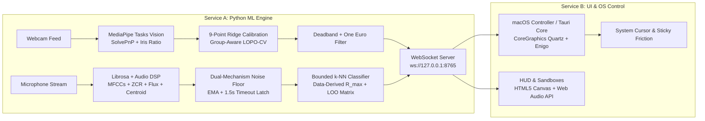

# Aura: Multimodal Intent Fusion

> **A deployment-ready, gamified accessibility overlay that bridges the gap between standard operating systems and users with severe motor and speech impairments.**

Aura fuses lightweight head/iris gaze tracking with real-time adaptive acoustic trigger matching to control operating system cursors without relying on heavy voice AI or jittery webcams.

---

## Architecture Overview



---

## Project Structure

```
aura/
├── aura_engine/
│   ├── vision/
│   │   ├── face_tracker.py       # MediaPipe Tasks Vision (Head Pose, Iris Ratio, Dynamic Blink)
│   │   ├── calibration.py        # 9-point grid calibration, GroupKFold LOPO-CV, Center/Edge/Corner metrics
│   │   └── one_euro_filter.py    # One Euro Filter with spatial deadband smoothing
│   ├── audio/
│   │   └── classifier.py         # Acoustic feature extraction, dual noise gate, frozen scaler, bounded k-NN
│   ├── os_bridge/
│   │   └── macos_controller.py   # Native Quartz OS mouse control, AXUIElement sticky buttons, Spacebar kill switch
│   ├── server.py                 # Local WebSocket telemetry server (60 FPS)
│   ├── models/                   # Serialized calibration and MediaPipe task assets
│   └── tools/
│       └── diagnostics_harness.py # Mathematical and statistical verification test suite
├── aura_ui/
│   ├── index.html                # Aura HUD, Pet Onboarding, Bubble Wrap Sandbox, Eye-Theremin
│   ├── style.css                 # Glassmorphic Nintendo-grade aesthetic and CSS animations
│   └── app.js                    # Web Audio synth, Canvas cursor cosmetics (UFO, Wand, Ink), Desktop Buddy
├── src-tauri/                    # Tauri v1.5 / Rust OS controller integration (enigo + tokio)
│   ├── Cargo.toml
│   ├── tauri.conf.json
│   └── src/main.rs
├── start_aura.py                 # Master launcher booting ML engine, UI server, and browser HUD
├── test_system_integration.py    # End-to-end integration test
└── requirements.txt              # Python ML dependencies
```

---

## Key Features & User Experience

1. **The Virtual Pet Mascot Onboarding ("Feed Pippin with Apples"):**
   - 9-point calibration grid. Apples appear across screen quadrants.
   - User targets each apple and makes their click sound to "feed" the pet.
   - Calculates leak-free Ridge regression with honest Center, Edge, and Corner out-of-sample error reporting.
2. **Nintendo-Tier Sound Design ("Juicy" UI):**
   - Web Audio API real-time synthesis: soft marimba blips on hover, ascending 3-tone chime on click, bubble pops.
3. **Cursor Cosmetics & Physics:**
   - **The UFO:** Faint green exhaust trail + vertical tractor beam on click.
   - **The Magic Wand:** Cascading stardust particle trail.
   - **The Ink Brush:** Smooth watercolor trajectory path.
4. **Interactive Sandboxes:**
   - **The Bubble Wrap Test:** 32 colorful popping bubbles for proving speed, accuracy, and joy.
   - **The Eye-Theremin:** 8-zone musical expression grid played by looking and vocalizing.
5. **The Reactive Desktop Buddy Mascot:**
   - Lives in the corner of the screen.
   - Eyes follow user gaze.
   - Displays sleeping cap and snores when Long Blink failsafe is engaged.
6. **Precision Hooks:**
   - **"Sniper" Magnifier (Dwell-to-Zoom):** 1.2s dwell triggers 3x picture-in-picture zoom bubble with 80% slowed micro-targeting.
   - **Dynamic Magnetic Friction ("Sticky" Buttons):** Queries macOS Accessibility API (`AXUIElement`) to slow cursor speed over interactive UI elements.
7. **Multi-Layered Failsafes:**
   - **Gaze-Compensated Long Blink:** MediaPipe blendshapes (`eyeBlink` + `eyeLookDown`) pause cursor after 1.3s hold.
   - **Extreme Pitch Abort:** Head tilt $>25^\circ$ toward ceiling halts mouse listening.
   - **Hardware Kill Switch:** `[SPACEBAR]` instantly disables OS mouse hijacking.
8. **Continuous Learning:**
   - **"Oops, learn that":** Ingests non-undone audio samples into dynamic memory bank without poisoning fixed calibration anchors.
9. **Easter Eggs:**
   - **Konami Code for Eyes:** Looking Top-Left $\rightarrow$ Top-Right $\rightarrow$ Bottom-Left $\rightarrow$ Bottom-Right unlocks secret themes.
   - **Zoomies:** Rapid head shaking temporarily transforms cursor into a speeding racecar.

---

## How to Run Aura

### 1. Launch Aura (Engine + HUD)
```bash
# From /Users/som/.gemini/antigravity/scratch/aura:
./venv/bin/python start_aura.py
```
This automatically boots the 60fps WebSocket telemetry engine and opens the interactive HUD at `http://127.0.0.1:5173`.

### 2. Enable Native macOS OS Cursor Control
In a separate terminal:
```bash
./venv/bin/python aura_engine/os_bridge/macos_controller.py
```
*Note: Ensure Terminal/Python has Accessibility permissions in System Settings > Privacy & Security > Accessibility.*
Press `[SPACEBAR]` at any time for the emergency kill switch.

### 3. Run Verification Tests
- Mathematical & DSP Diagnostics:
  ```bash
  export MPLCONFIGDIR=/tmp/mpl
  ./venv/bin/python aura_engine/tools/diagnostics_harness.py
  ```
- End-to-End System Integration:
  ```bash
  export MPLCONFIGDIR=/tmp/mpl
  export OPENCV_AVFOUNDATION_SKIP_AUTH=1
  ./venv/bin/python test_system_integration.py
  ```
